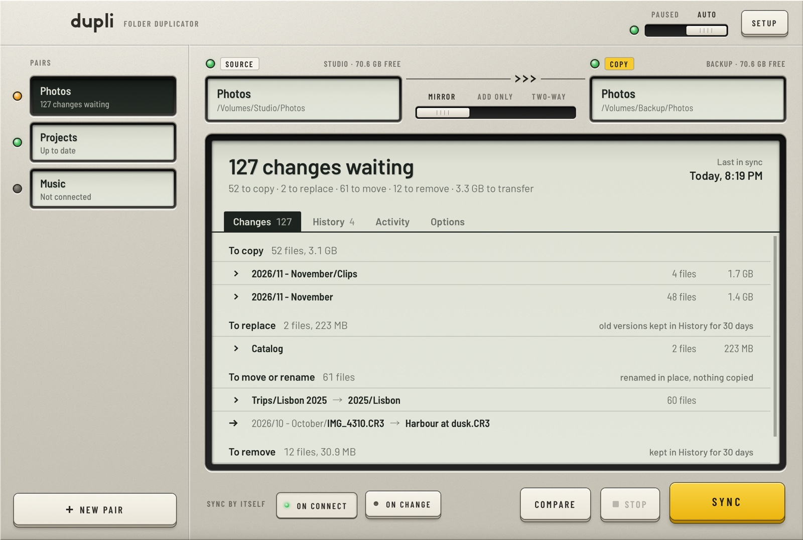
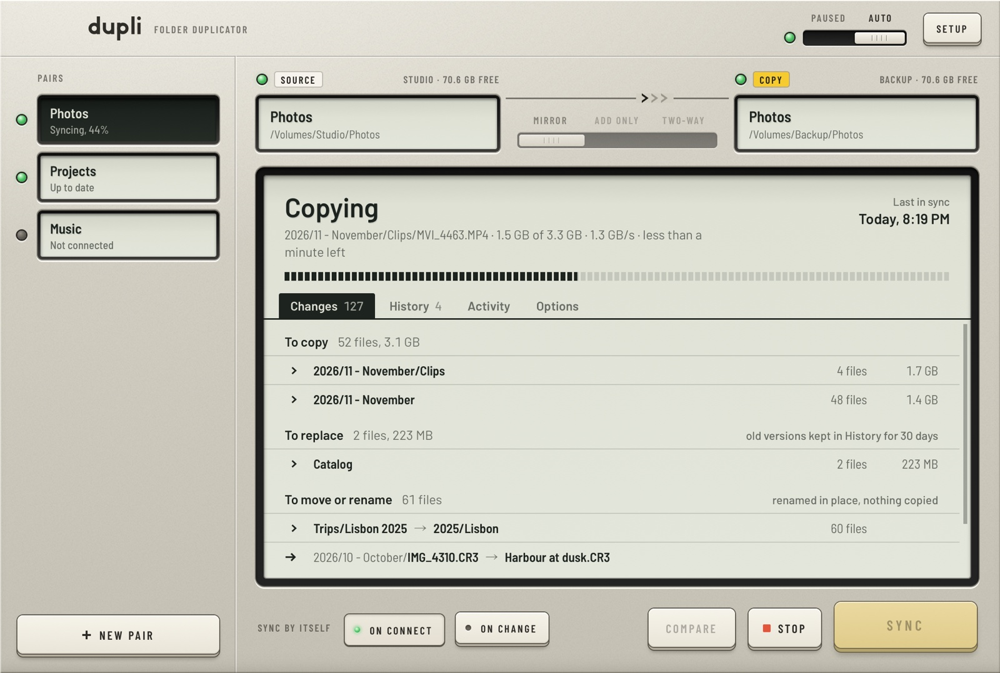
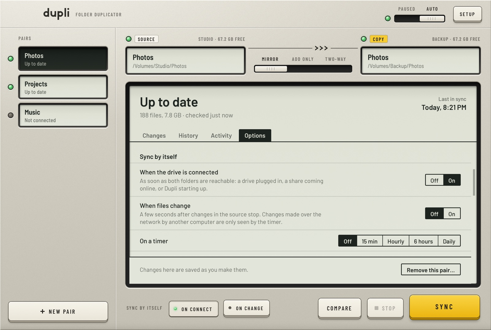
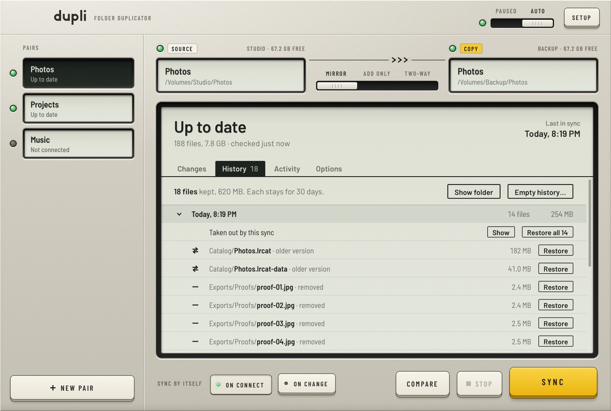

<p align="center"></p>

Dupli is an application for macOS and Windows. It keeps a copy of a folder the same as the source folder.

Dupli compares the two folders. Then it changes only the files that are different. This makes a sync faster than a full copy.



## Functions

- A pair has a source folder and a copy folder. You can have many pairs.
- Each pair has one of three modes:
  - **Mirror**: Dupli makes the copy folder the same as the source folder.
  - **Add only**: Dupli adds new files and changed files. It does not remove files.
  - **Two-way**: Dupli moves each change from one folder to the other folder.
- **Compare** shows the changes before a sync. It does not change a file.
- If you move a file or change its name, Dupli does the same in the copy folder. It does not send the file again.
- Dupli keeps removed files and replaced files in a history folder.
- Dupli can start a sync automatically when you connect a drive, when files change, or at an interval.
- When you close the window, Dupli stays in the menu bar (macOS) or in the system tray (Windows).
- Dupli makes a sound when you click a key and when a sync is completed.

## Safety

- In the **Mirror** mode and the **Add only** mode, Dupli only reads the source folder.
- If a folder is not connected, Dupli does not start a sync.
- If a sync will remove more than 30% of the copy folder, Dupli stops. The sync continues only when you click **Sync anyway**.
- Dupli writes each file with a temporary name. Then it gives the file its correct name.
- Dupli does not replace a file that changed after Dupli compared the folders.

## Installation

The application packages are in the `builds` folder.

### macOS (Apple silicon)

1. Open `builds/macos/Dupli_0.1.0_aarch64.dmg`.
2. Move **Dupli** into the **Applications** folder.
3. Open Dupli.

The application has no Apple signature. If macOS does not open Dupli, do these steps:

1. Open **System Settings**.
2. Select **Privacy & Security**.
3. Click **Open Anyway**.

### Windows (64-bit)

1. Open `builds/windows/Dupli_0.1.0_x64-setup.exe`.
2. Obey the instructions on the screen.

The installer has no signature. If Windows shows a SmartScreen message, do these steps:

1. Click **More info**.
2. Click **Run anyway**.

The file `builds/windows/Dupli.exe` is the application without an installer.

Note: There was no test of the Windows version on a Windows computer.

## How to use Dupli

### How to make a pair

1. Click **New pair**.
2. Select the source folder.
3. Select the copy folder.
4. Select the mode.
5. Click **Create pair**.

### How to do a sync

1. Click **Compare**. Dupli shows the changes.
2. Click **Sync**.



### Automatic sync

The **Options** tab has the adjustments for each pair. Dupli can start a sync at these times:

- When the drive is connected.
- When files change.
- At an interval.



## History folder

The history folder is in the copy folder. Its path is `.dupli/history`. Each sync that removes files makes one folder there. The name of that folder is the date and the time.

To use a file from the history folder again, do these steps:

1. Open the **History** tab.
2. Open the applicable date.
3. Click **Restore**.

Dupli puts the file in the source folder and in the copy folder. If a newer file has the same name, Dupli gives the old file a different name.



## Sounds

Dupli makes each sound from noise and sine waves. There are no audio files.

To stop the sounds, do these steps:

1. Click **Setup**.
2. Set **Sounds** to **Off**.

## How to compile the source code

Rust 1.88 or a later version is necessary.

To start the application, use this command:

```bash
cargo run -p dupli
```

To do the tests, use this command:

```bash
cargo test
```

To make the application package, use this command:

```bash
npx @tauri-apps/cli@2.12.4 build
```

## Structure

- `core`: the sync engine. It has no window.
- `src-tauri`: the application. It has the window, the tray, and the schedule.
- `ui`: the contents of the window (HTML, CSS, JavaScript).
- `builds`: the application packages for macOS and Windows.
- `docs`: the images for this file.

## Limits

- Dupli does not keep extended attributes (for example, Finder tags) in the copy.
- Dupli does not find changes that a different computer makes on a network share. Use the interval for a pair on a network share.
- There was no test of the Windows version on a Windows computer.
- On Windows, Dupli cannot eject a drive.

## Font

The typeface is Barlow. Barlow has the SIL Open Font License. Refer to `ui/fonts/OFL-Barlow.txt`.
